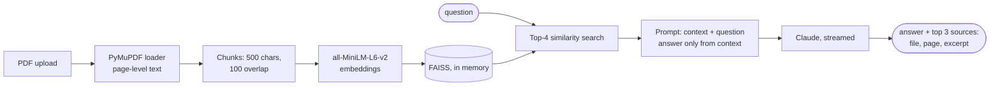

# Claude PDF RAG Chatbot

**Upload PDFs and chat with them: answers are generated by Claude from the passages retrieved for each question, and every answer shows the pages it came from.**

**[Live demo →](https://claude-pdf-rag-chatbot.streamlit.app/)** (bring your own Anthropic API key; the app may take a few seconds to wake up)

[](https://github.com/dojedaro/claude-pdf-rag-chatbot/actions/workflows/notebooks.yml)

## How it works



| Choice | Why |
|---|---|
| **FAISS in memory** instead of a vector database | Streamlit Community Cloud has no persistent disk; an in-memory index rebuilds per session and avoids SQLite issues |
| **Local embeddings** (`all-MiniLM-L6-v2`) | Free, fast on CPU, and documents never leave the app for embedding |
| **Retriever cached per upload** (`st.cache_resource`) | Re-asking about the same PDFs doesn't re-embed them |
| **Streaming** | Answers appear token by token instead of after a long pause |
| **Top 3 sources under every answer** (file, page, excerpt) | The reader can check the claim against the page |

The model picker offers Claude Haiku 5.5 (default, cheapest), Sonnet 5.5 and Opus 5.5.

## Run it

```bash
pip install -r requirements.txt
cp .env.example .env          # add ANTHROPIC_API_KEY
streamlit run app/app.py
```

On Streamlit Cloud, put `ANTHROPIC_API_KEY` in the app's secrets. `End_to_End_RAG_Chatbot_App.ipynb`
is the notebook the app was developed in.

## Stack

Python, Streamlit, LangChain (loaders, splitters, retriever), FAISS, sentence-transformers, Anthropic SDK.

## Limitations and next steps

- **No evaluation yet.** The prompt asks Claude to answer only from context, but nothing measures how
  often it does. Next: a small set of answerable and unanswerable questions per test PDF, scoring
  correct answers and correct refusals.
- Similarity search alone misses exact terms (names, codes); hybrid BM25 + vector retrieval would help.
- Ask Claude to cite chunk numbers inline, and check the citations in code, as
  [factcheck-agents](https://github.com/dojedaro/factcheck-agents) does.

## License

MIT
